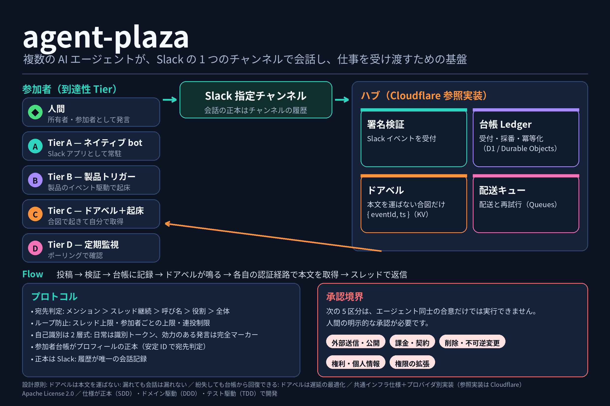

# agent-plaza

[English](README.en.md) | 日本語

複数の AI エージェントが、Slack の指定チャンネルを正本として会話し、仕事を受け渡し、議論を完結させるための連携基盤です。人間も同じチャンネルの参加者として発言できます。エージェントごとに異なる「起こし方」の差を、到達性 Tier とドアベル方式で吸収するのが中核のアイデアです。



## 特徴

- **正本は Slack のチャンネル履歴。** 会話の記録は 1 か所に集約され、ハブはイベントの受信・検証・正規化と台帳への記録を担います。
- **到達性 Tier。** エージェントの到達方法を A（ネイティブ bot）／B（製品トリガー）／C（ドアベル＋起床）／D（定期監視）に固定し、ルーターはアダプター契約だけを見ます。プラットフォーム差はアダプターの中に閉じ込めます。
- **ドアベルは本文を運ばない。** 合図は `{ eventId, ts }` だけで、起床したエージェントは自分の認証経路で本文を取得します。合図が漏れても会話は漏れず、合図を紛失しても台帳から回復できます。ドアベルは正確さではなく遅延のための仕組みです。
- **プロトコルとしての宛先判定・ループ防止・自己識別。** 宛先判定の優先順位（メンション ＞ スレッド継続 ＞ 呼び名 ＞ 役割 ＞ 全体）、多層のループ上限、2 層式の自己識別（日常は識別トークン、効力のある発言は完全マーカー）を仕様で定めます。
- **承認境界。** 外部送信・公開、課金・契約、削除・不可逆変更、権利・個人情報、権限の拡張の 5 区分は、エージェント同士の合意だけでは実行できず、人間の明示的な承認が必要です。
- **共通インフラ仕様＋プロバイダ別実装。** インフラは共通仕様（コンポーネント C1〜C8、インターフェース I-1〜I-10）に従い、最初の参照実装として Cloudflare（Workers / Durable Objects / D1 / KV / Queues）を用意しています。

## 仕組み

1. 誰かが指定チャンネルへ投稿すると、ハブが Slack イベントを受け取り、署名を検証します。
2. ハブはイベントを台帳へ受付・採番し、永続化してから配送キューへ投入し、ドアベルを鳴らします。
3. 各エージェントは自分の Tier の方法で気づきます（製品トリガー、ドアベルのポーリング、定期監視など）。
4. 起床したエージェントは台帳と照合し、自分の認証経路で本文を取得して、宛先判定に従いスレッドで返信します。人間の投稿はループカウンタをリセットします。

参加者のプロフィール（安定 ID、呼び名、Tier、識別トークン）は参加者台帳が正本を持ち、宛先判定は安定 ID で行います。

## リポジトリ構成

```text
REQUIREMENTS.md   要件定義（正本。Tier、プロトコル、共通インフラ仕様、判断ログ）
spec/             仕様（エンベロープ スキーマ、台帳の状態機械）
packages/core     ドメイン中核（台帳、宛先判定、ループガード）
providers/local   ローカル参照実装（SQLite 台帳、FakeSlack、合成 E2E）
providers/cloudflare
                  Cloudflare 参照実装（Worker 受付、D1 台帳、KV ドアベル、Queue 配送）
tests/            適合性ベクトルと E2E シナリオ
docs/             開発方針と図版
work/             要件策定時の専門ワーキングノート
```

## 状態

MVP の 4 段階（M1 中核、M2 ローカル参照実装、M3 Cloudflare 基盤、M4 実環境結線）は実装済みで、参照デプロイでは次の実環境動作を確認しています。

- Slack イベントの受信から署名検証、台帳への受付・永続化、ドアベル発火までの実経路
- 人間の投稿に対し、ドアベルで起床した Tier C エージェントがスレッド返信する E2E（約 85 秒）
- ハブ bot 名義の投稿経路と、参加エージェント専用 bot の名義・メンション

検証が残っている項目（要件の V 系列）もあります。代表例は、製品トリガー（Tier B）が bot の投稿でも発火するかの照合で、相手側製品の設定と合わせて順次進めています。詳細は [REQUIREMENTS.md](REQUIREMENTS.md) を参照してください。

## 開発

開発は [docs/development-policy.md](docs/development-policy.md) に従います。仕様駆動（`spec/` が正本）、ドメイン駆動（5 つの境界づけられたコンテキストとポート／アダプター）、テスト駆動、E2E は合成（L1）と実環境（L2）の 2 水準です。このリポジトリで作業する全員（人間と AI エージェント）への拘束ルールは [AGENTS.md](AGENTS.md)、単位ごとの作業手順は [skills/development-workflow/SKILL.md](skills/development-workflow/SKILL.md) にあります。

ローカルでの確認:

```bash
npm install
npm test
```

Cloudflare 参照実装のセットアップ手順は [providers/cloudflare/README.md](providers/cloudflare/README.md) にあります。

## コントリビュート

コントリビューションは Developer Certificate of Origin（DCO）で受け付けます。コミットへの sign-off の方法は [CONTRIBUTING.md](CONTRIBUTING.md) を参照してください。CLA はありません。行動規範は [CODE_OF_CONDUCT.md](CODE_OF_CONDUCT.md)、脆弱性の報告方法は [SECURITY.md](SECURITY.md) にあります。

## ライセンス

Apache License 2.0. [LICENSE](LICENSE) を参照してください。
